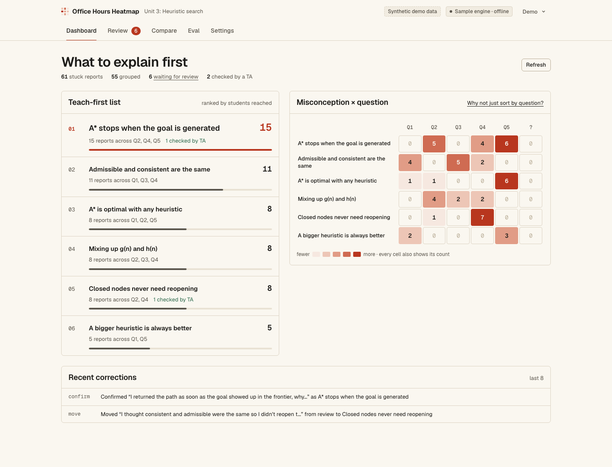
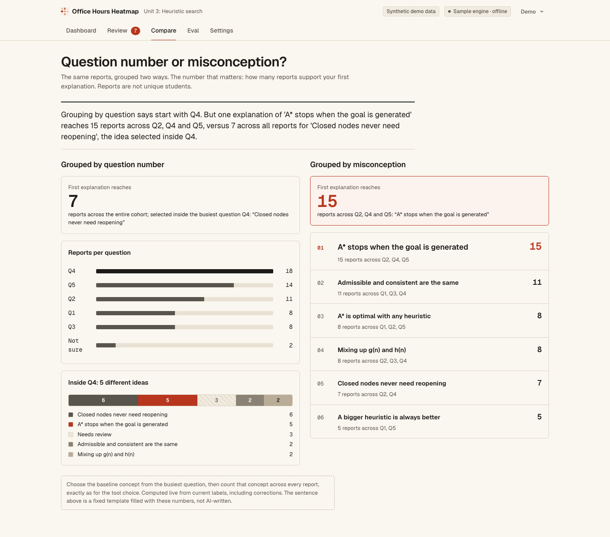
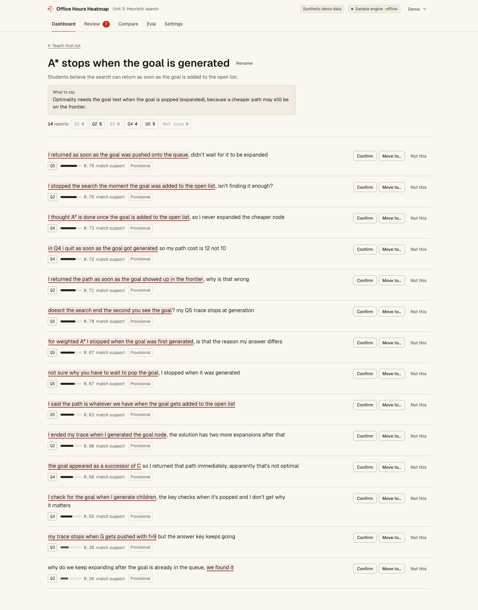
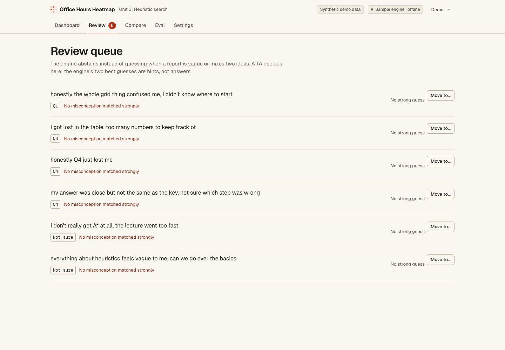
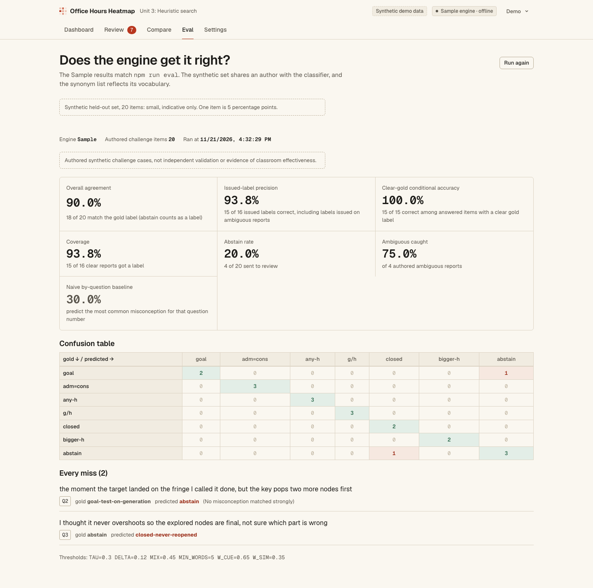
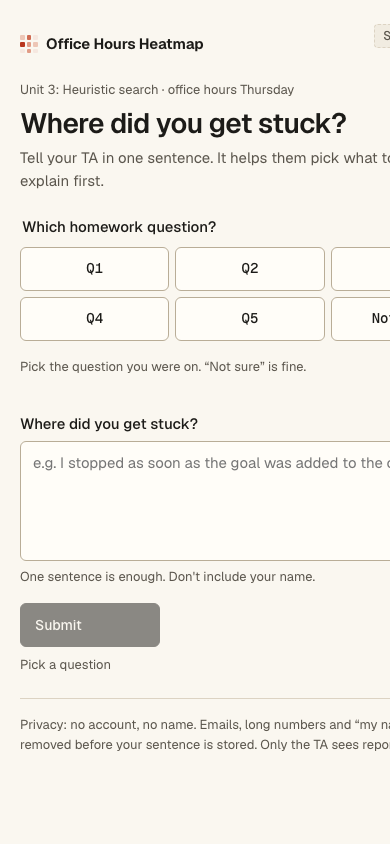

# Office Hours Heatmap

Students say where they got stuck in one sentence. The TA sees which **misconception** to explain first,
not which homework question got the most complaints.



> Built for SLAY HACKS 2026. Every report, question and number in this repo comes from **synthetic demo
> data** written for the project. Runs fully offline with zero configuration.

## The problem

One user, one painful task: a **TA**, ten minutes before office hours, reading a pile of free-text "I got
stuck" notes and deciding what to explain first at the whiteboard.

Today those notes get sorted by homework question number. But one misconception spreads across several
questions, and one question hides several misconceptions. The by-question view points at the wrong first
explanation. In the demo data, Q4 has the most complaints (17), but the most common idea inside Q4 is shared
by only 6 students. Explaining "A* stops when the goal is generated" reaches 14 students across Q2, Q4 and Q5.

## What it does

- **Student form** (`/submit`): pick a question, write one sentence, submit. No account, no name, and the
  student never sees a label. Emails, long numbers and "my name is…" are redacted before storage.
- **Teach-first list** (`/ta`): misconceptions ranked by how many students one explanation reaches, each with
  a reason line ("14 reports across Q2, Q4, Q5"), next to a misconception × question heatmap.
- **Cluster detail** (`/ta/m/[id]`): every report in a misconception, with the engine's evidence
  **quoted word for word** and underlined, a confidence bar, and a one-line "What to say" teaching hint.
  Confirm, Move to…, Not this, or rename the misconception inline. Every correction is logged.
- **Review queue** (`/ta/review`): when a report is vague or mixes two ideas, the engine **abstains** instead
  of guessing. A TA assigns it with one click, with the engine's top guesses as hints.
- **Compare view** (`/ta/compare`): the same reports grouped by question number and by misconception, with
  "first explanation reaches N students" for each and a template sentence (not AI-written) stating the gap.
- **Evaluation** (`/ta/eval`, `npm run eval`): measured metrics on a held-out synthetic set, a confusion
  table, and every miss.
- **Optional live model** (`/ta/settings`): plug in any OpenAI-compatible endpoint with your own key.

| Compare view | Cluster detail |
|---|---|
|  |  |

| Review queue | Evaluation | Student form (390px) |
|---|---|---|
|  |  |  |

## The demo moment

Open `/ta/compare`. Grouping by question says start with Q4. The most common idea inside Q4 reaches
**6** students. One explanation of "A* stops when the goal is generated" reaches **14** students across Q2, Q4
and Q5. Then click that misconception and read the students' own words, with the evidence underlined in red
pencil.

## How it works

```
Browser (React client components)                 Next.js server (same process)
  /submit, /ta/*  -- useTRPC() + TanStack Query -->  /api/trpc/[trpc]
  Live config: localStorage only                     appRouter (typed end to end)
                                                       report / dashboard / cluster / review /
                                                       correction / compare / admin
                                                         └─ in-memory store (globalThis), seeded with 60 reports
                                                       engine.rerun / engine.test ──> live adapter (optional)
                                                       eval.run / eval.runLive ──> held-out set (20)

Every engine result ──> validateResult() (zod) ──> label + verbatim evidence, or ABSTAIN with a reason
```

**Sample engine** (default, deterministic, offline): synonym normalisation (`frontier|fringe|open list` →
one token, etc.), weighted cue patterns per misconception, TF-IDF similarity to each misconception's
definition, combined as `0.65·cue + 0.35·similarity`. It abstains when the sentence is too short, the top score
is weak (`TAU`), the top two are too close (`DELTA`), or the runner-up is strong on its own (`MIX`, a report
mixing two ideas). Evidence is the clause of the original sentence that scored highest, so it is always a
real substring. TA confirms and moves become exemplars, so a similar new report can land correctly after a
correction (the eval always uses a clean engine without exemplars).

**Shared validator** (`src/engine/contract.ts`): both engines' output must parse with zod, name an id from the
taxonomy, quote evidence that is an exact substring of the report, and clear a confidence floor. Anything else
becomes an abstain with a reason (ADR 0003).

**Live engine** (optional): `POST {baseUrl}/chat/completions` with a strict JSON schema, falling back to
`json_object` on HTTP 400; 20 s timeout, max 6 concurrent; any failure abstains with "Live engine error:
{status}" and never echoes the key.

## Sponsor tech & why it is necessary

No sponsor APIs are used. The stack is open source:

| Tech | Why it is needed here |
|---|---|
| **tRPC v11** + **TanStack Query** | One typed contract from the store to every screen; every correction invalidates dashboard, cluster, review and compare so counts update without reloads. |
| **zod** | Validates tRPC inputs and is the AI output gate: unquoted or unknown labels can't reach the TA. |
| **Next.js 16 (App Router)** | Serves UI and API in one process; `npm install && npm run dev` is the whole setup. |
| **Vitest** + **tsx** | 63 unit tests and the `npm run eval` script. |

## Quickstart

Requires Node 22.

```bash
npm install
npm run dev        # http://localhost:3000
```

Other commands: `npm test` (Vitest), `npm run eval` (held-out evaluation), `npm run build && npm run start`.

Walkthrough: `/` → "I'm a student" → submit one sentence → "I'm a TA" → `/ta` → `/ta/compare` → click the top
misconception → confirm or move a report → `/ta/review` → assign one → `/ta/eval`. "Demo → Reset demo data" in
the TA header restores the 60 seed reports.

## Sample mode vs live mode

| | Sample mode (default) | Live mode (optional) |
|---|---|---|
| Setup | None | `/ta/settings`: base URL, model, API key |
| Engine | Deterministic Sample engine | Any OpenAI-compatible Chat Completions model |
| Network | None | Only while a re-run or live eval runs |
| Labelled in UI | "Sample engine · offline" badge | "Live engine · {model}" badge |
| Key storage | n/a | This browser's localStorage only; forwarded per request, never stored or logged by the server |

Sample mode makes the whole demo clickable with no key. The live engine was tested only against a mocked
`fetch` (see Known limitations).

## Measured results

From `npm run eval`, first frozen run, 2026-11-20, commit `f5a6f56` (full output in
[`docs/EVAL.md`](docs/EVAL.md)). Synthetic held-out set, 20 items: small, indicative only.

| Metric | Sample engine |
|---|---|
| Overall agreement | 90.0% (18/20) |
| Accuracy when answered | 100.0% (15/15) |
| Coverage | 93.8% (15/16) |
| Abstain rate | 20.0% (4/20) |
| Ambiguous caught | 75.0% (3/4) |
| Naive by-question baseline | 30.0% |

Read these with care: the same author (AI-assisted) wrote the seed set, the held-out set and the cue patterns
in one session, and the spec's synonym list was chosen to cover held-out vocabulary. Treat them as a sanity
check, not as evidence about real student writing. Both misses are listed on `/ta/eval`.

## Judging criteria → where to see proof

| Criterion (weight) | Where to look |
|---|---|
| Innovation & originality (25) | `/ta/compare`: grouping by misconception across questions picks a different first explanation; abstain by default (ADR 0001, 0003) |
| Technical implementation (25) | Typed tRPC v11 routers (`src/trpc/routers`), zod-validated engine contract, deterministic engine, 63 tests, `npm run eval` |
| Real-world impact (20) | `/ta` teach-first list: the TA's ten minutes; "first explanation reaches N students"; works offline with zero setup |
| AI integration & responsible use (15) | Verbatim evidence (`/ta/m/…`), abstain + review queue (`/ta/review`), logged corrections, no labels to students, redaction, held-out numbers with misses (`/ta/eval`), key never stored (`/ta/settings`) |
| UX & presentation (15) | "Marked-up answer sheet" design: one pencil-red accent, Geist type, tabular numbers, visible focus rings, heatmap cells with aria-labels and printed counts, 390px student form |

## Project structure

```
src/
  app/            routes: /, /submit, /ta, /ta/m/[id], /ta/review, /ta/compare, /ta/eval, /ta/settings, /api/trpc
  components/     TeachFirstList, Heatmap, ReportCard, EvidenceText, ConfidenceBar, MoveMenu, EvalView, …
  domain/         types, taxonomy, questions, redact, ranking, heatmap, compare (pure functions)
  engine/         contract.ts (validator), sample/ (normalize, clauses, cues, tfidf, classify), live/
  store/          memory.ts (in-memory state, corrections, exemplars)
  data/           seed.ts (60 reports), heldout.ts (20 reports)
  eval/           metrics.ts, runEval.ts
  trpc/           init, client, server, routers/
scripts/          eval.ts, tune-seed.ts (seed-only tuning helper)
tests/            Vitest suites
docs/             SPEC, PLAN, GRILL, RESEARCH, EVAL, adr/, images/
```

## Known limitations

- **In-memory, per-instance state.** Reports and corrections live in server memory and reset on restart; on a
  serverless host each instance has its own copy. No database by design.
- **No authentication.** Anyone with the URL can open the TA pages. Fine for a demo, not for a class.
- **Synthetic data only.** Taxonomy, homework questions and all 80 reports were written for the project.
- **Small eval set.** 20 held-out items; one item is 5 percentage points. See the caveats above.
- **Live engine verified only with a mocked `fetch`** (happy path, 400 retry, HTTP error, timeout, invented
  evidence). It has not been run against a real provider in this repo.
- **Fixed taxonomy.** New kinds of confusion surface only through the review queue (ADR 0001).
- Not done from the plan: a full keyboard-only audit and 375px screenshots of every TA page (the TA pages stack
  below 900px but were only spot-checked), and a from-scratch `rm -rf node_modules` reinstall check.
- The official tRPC agent-skill docs (`npx @tanstack/intent load …`) could not be loaded in the build
  environment; the tRPC wiring follows the published TanStack React Query integration pattern instead.

## How this was built

This project was built with significant AI assistance. An AI coding agent planned the product (spec, design
interview, ADRs), wrote the code, the synthetic data, the tests and this README, working under the author's
direction. The evaluation numbers come from actually running `npm run eval`; nothing was typed in by hand.

## License

[MIT](LICENSE)
